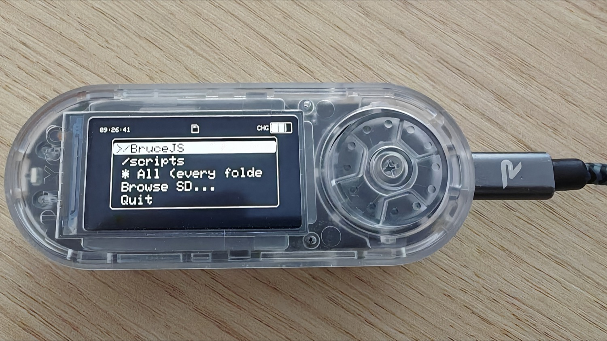
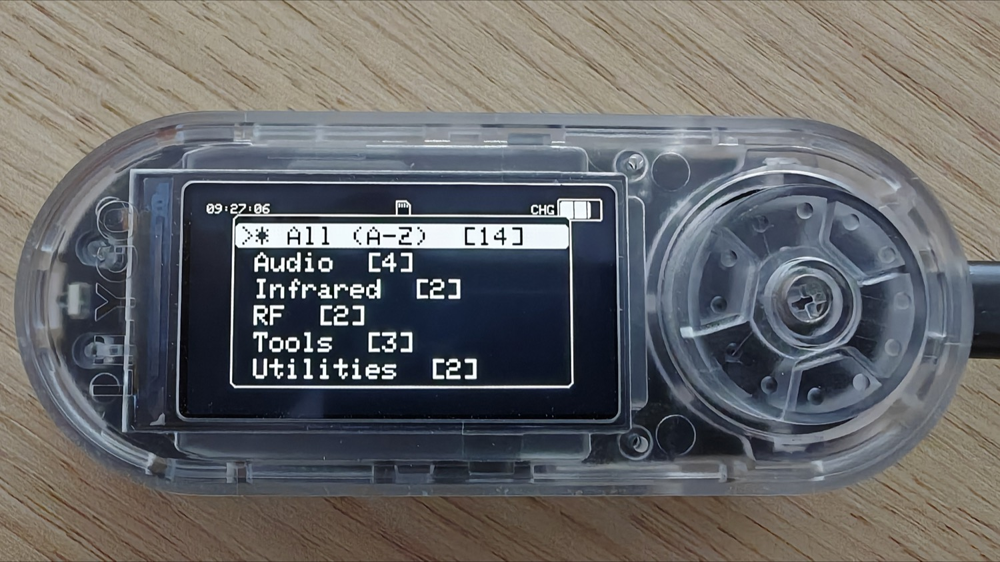

# 🚀 Bruce Launcher — a favorites menu for your JS scripts

🇺🇸 <b>English</b> · 🇫🇷 <a href="README.fr.md">Français</a>

  

A **launcher / favorites menu** for your JavaScript scripts on the **[Bruce](https://github.com/BruceDevices/firmware)** firmware (tested on the **LilyGO T-Embed CC1101**). It **recursively scans** `/BruceJS`, `/scripts`, `/BruceScripts` **and their sub-folders**, groups scripts by category, and runs the one you pick with `load()`.

👉 **The problem it solves:** the Bruce **App Store** files downloaded scripts into **sub-folders** (`wifi/`, `RFID/`, `ir/`…). But the built-in **Interpreter** menu only shows the **root** of a folder → those scripts are **invisible**. This launcher finds them all and builds you a real menu.

| Folder picker | Categories (sub-folders) |
|------------------|----------------------------|
|  |  |

## ✨ Features

- **Recursive scan** (up to 4 levels) of `/BruceJS`, `/scripts`, `/BruceScripts`.
- **3-level menu**:
  1. **Folder** — `/BruceJS` (default), another one, **`* Tout`** (all), or **`Browse SD...`** to point at any folder on the SD card.
  2. **Category** — the sub-folders (wifi, RFID, ir…) with the **number of scripts**, or **`* All (A-Z)`**.
  3. **Script** → run with `load()`.
- **Automatic return to the menu** when a script ends (or calls `exit()`).
- Built-in **SD browser** (`..` to go up, *Pick HERE* to choose the current folder).
- **Hides itself** from the list.

## 🚀 Installation

1. Copy **`Launcher.js`** to the **root** of a folder Bruce reads: **`/BruceJS`** (recommended), `/scripts` or `/BruceScripts`.
2. On the device: **Interpreter → `Launcher.js`**.
3. **(Tip)** Set it as **Config → Startup App** → at boot you land straight on your favorites menu. 🎯

## ⚙️ Settings (top of the script)

- `ROOTS` — folders scanned by default.
- `MAX_DEPTH` — recursive search depth (4 by default).
- `SELF` — file names not to list (the launcher itself).

## 📝 Notes

- Uses the interpreter's native functions: `storage.readdir(dir, {withFileTypes:true})` and the global **`load(path)`**.
- The **category** = the first sub-folder under the chosen folder (mirrors the App Store categories). Scripts at the root are grouped under **`(root)`**.
- Interface in **English** (like the rest of the Bruce firmware).

## 🛒 Hardware

*Amazon affiliate links: if you buy through these links, the project earns a small commission at no extra cost to you.*

<table>
<tr>
<td align="center" width="33%">
   
  <b><a href="https://www.amazon.com/dp/B0D45MSMJR?linkCode=ll2&amp;tag=koua29blauncher-20&amp;ref_=as_li_ss_tl">Anker 545 power bank (10,000 mAh)</a></b> Keeps the T-Embed running away from an outlet
</td>
<td align="center" width="33%">
   
  <b><a href="https://www.amazon.com/dp/B0C1FCZM94?linkCode=ll2&amp;tag=koua29blauncher-20&amp;ref_=as_li_ss_tl">433 MHz SMA antenna (2-pack)</a></b> Sub-GHz antenna for the CC1101 radio
</td>
<td align="center" width="33%">
   
  <b><a href="https://www.amazon.com/dp/B0B7NVMBPL?linkCode=ll2&amp;tag=koua29blauncher-20&amp;ref_=as_li_ss_tl">SanDisk 64 GB microSD (2-pack)</a></b> For Bruce themes, scripts and captures
</td>
</tr>
</table>

As an Amazon Associate I earn from qualifying purchases.

## ☕ Buy me a coffee

## 📄 License

MIT — see [LICENSE](LICENSE). By **koua29**.
